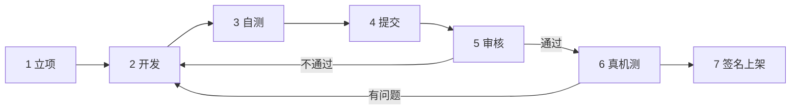

# 从立项到上架

一个应用从想法到用圆屏的人能装上，走下面七步。你做前四步，我们（Tikpal）做后三步；双方只在「提交单」上交接。每一步的条件、命令和交什么，[AGENTS.md](../AGENTS.md) 里写得更全；两份对不上时以它为准。

开发包仓库是公开的，里面的单子谁都看得见：**不要贴账号、手机号、邮箱、设备编号、令牌**；日志用 `./kit logs`、`./kit info` 出来的（已经抹掉了设备编号）。账号这类要私下告诉我们。

## 1. 立项（你提，我们回）

在开发包仓库开一张「立项」单，写这几样：

- **slug**：应用的名字，小写字母、数字和连字符，字母开头，2–24 个字符，比如 `my-timer`。定了就不改，商城和圆屏都靠它认应用。
- **中文名、英文名**，**一句话说它能做什么**。
- **3–5 个用户会说的话**：点了名的（「打开计时器」），和没点名、只说想做什么的（「帮我计时十分钟」）。Yay 找应用主要靠后一类。
- **要不要云能力**（AI 对话、语音识别、语音合成……）和**要哪些硬件**（麦克风、喇叭、姿态、TF 卡）。

我们在立项单上替你查商城和已经登记的应用，回你 slug 能不能用。

要云能力的，**开通要我们部署一次，可能得等**；能力或限额改了，要再开通一次。不要云能力的，不用等，直接开发。

## 2. 开发

- `./kit new <slug>` 起仓库（[上手](getting-started.md)）。一个应用一个仓库，放在你自己的 GitHub 上。仓库可以公开；私有的话，把 `vzheng56` 加成协作者。
- 照[应用开发指南](app-guide.md)和[圆屏设计规范](round-screen-design.md)写；应用清单照 [app.json 规范](app-json.md)。
- 开发包（`devkit/`）只读。组件缺什么能力，在开发包仓库开「需求」单，我们做进下一版开发包；不要在你的仓库里改组件或者复制一份改。
- 换开发包版本：`./kit update <版本>`，编译、自测过再提交。
- **版本号只往上走。** 圆屏查更新时不看账号有没有这个应用，只看位置上装的 slug 和版本号：商城里只要有同一个 slug、版本更新的发布，就把你用 USB 写进去的那份当成旧版，用户一点更新就换成商城上的版本。所以 slug 立项时我们就查重名；上架以后接着开发，USB 写的版本号也不能比商城上的低。

## 3. 自测

照[兼容检查清单](checklist.md)走一遍，每项都要留证据：

- 截图（`./kit snap`）对照设计规范；
- 内存日志（`./kit heap`）：内部 RAM 最低不低于 **40 KB**；
- 双击侧键开应用环，点中间回到 Yay；从应用环换到别的应用再回来；
- 没网、低电量下的样子；中文和英文两套界面文字都放得下（日文、西班牙文账号现在显示英文）。

## 4. 提交

先 `./kit build --release`，再跑 `./kit check`，要全过（最后一行是「✓ 都过了」）。然后在开发包仓库开一张「提交」单（有现成的格式），填：

- 应用名、版本号，这一版做了什么；
- 应用仓库地址和**提交号**（完整 40 位）；
- 用的哪个开发包版本（`./kit version`）；
- 应用仓库 CI（GitHub Actions 的 Check）里 `./kit check` 打出来的提交号和镜像 SHA-256（照抄），那一次的整段输出和运行链接；

  Mac 上编的和 Linux（GitHub 的机器、我们审核重编的地方）编的永远差 60 几个字节：乐鑫两个平台的工具链在调试信息里带的路径不一样，ELF 哈希和它带出来的两处校验跟着变，代码和数据一字不差。所以 SHA-256 填 CI 里的，不填 Mac 上的；Mac 上编的照样拿去自测。
- 自测证据：截图、内存日志、清单打勾。

提交单是双方唯一的交接点。审核意见也回在这张单上；改完在同一张单上再提一次（版本号加一、新的提交号）。

## 5. 审核（我们）

1. **按提交号重编**：在 GitHub 的机器上、跟你应用仓库 CI 一样的容器里，用你写的那个开发包版本，把那个提交重编一遍。编出来的字节要和你交的 SHA-256（CI 里的）一样。对不上就退回：多半是有没提交的改动，或者用了别的开发包版本。要拿你 Mac 上编的对，用 `devkit/tools/compare_images.py`：只差 ELF 哈希和两处校验，就是代码相同。
2. **自动检查**：镜像不超过 3.5 MB；`app.json` 合规；主机测试通过；提交用的那份不带开发命令。`app.json` 里要的能力，和给你开通的对一遍，多要的会请你删掉。
3. **看代码**：按[兼容检查清单](checklist.md)和设计规范看，有问题回在提交单上。

## 6. 真机测（我们）

我们用 USB 把重编出来的那份写进我们的测试圆屏，走一遍。测试阶段不进商城：商城里的预览版所有用圆屏的人都看得到、都能装。

## 7. 签名上架（我们）

我们决定公开以后，用发布密钥签名、打包，在商城登记，先上**预览版**，以后再转正式版。签名只对审过、重编对上的那份镜像做；签名密钥只在我们的发布机上，不经过你。

上架以后要改：改代码、版本号加一，从第 3 步再走一遍。
